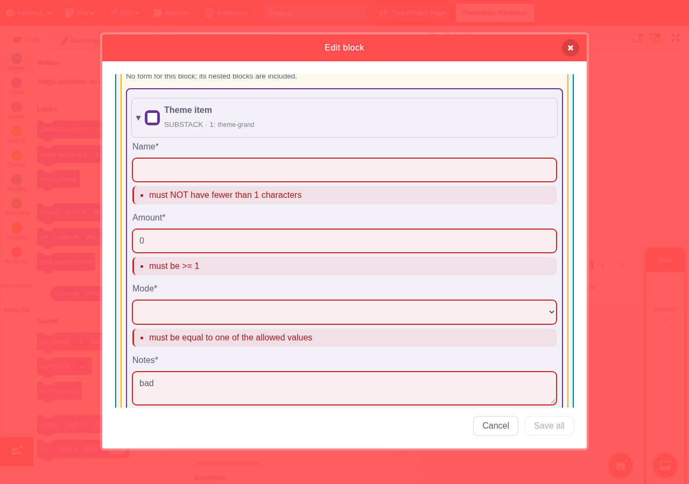
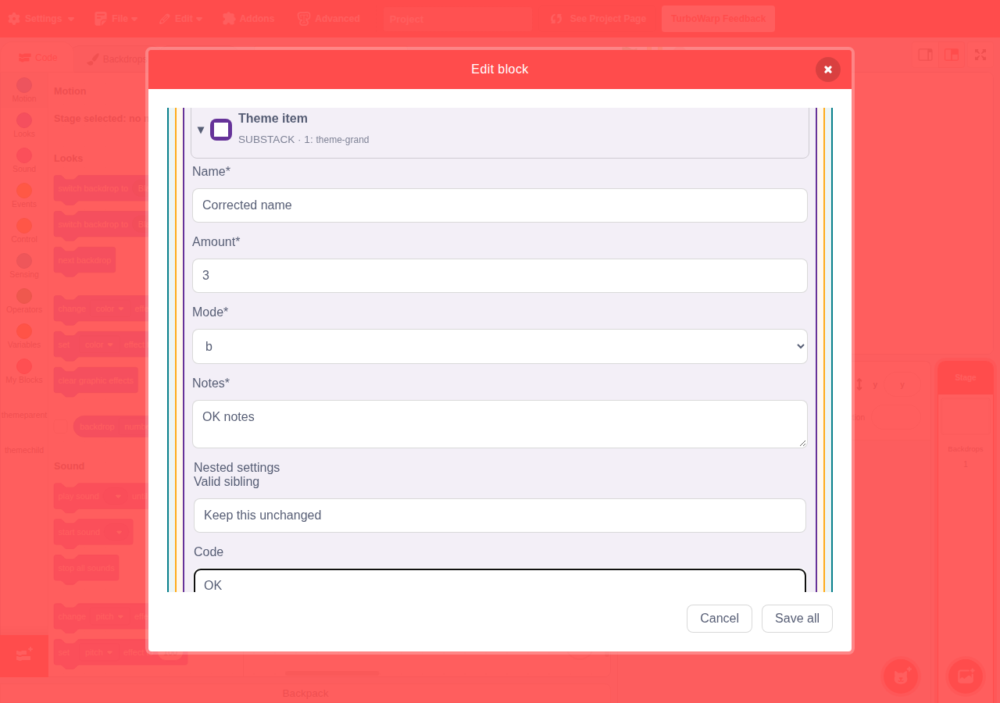
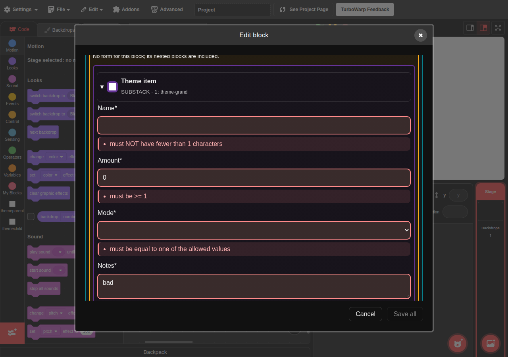
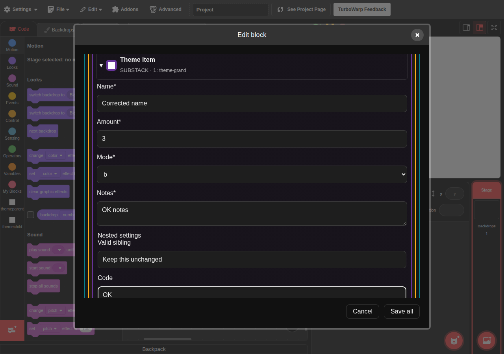

# Issue #12 公開配信後E2Eの証跡（2026-10-18）

[Issue #12](https://github.com/kubohiroya/turbowarp-extension-data-editor/issues/12)で確認した、[Pages配信後のActions実行 39092358787](https://github.com/kubohiroya/scratch-gui/actions/runs/39092358787)の画像と実測JSONを保存しています。artifactの保存期間が過ぎても、このディレクトリのコミット固定リンクから参照できます。ローカル実行の画像・測定値は含めていません。

## 対象と結果

| 項目 | 値 |
| --- | --- |
| 公開ページ | https://kubohiroya.github.io/scratch-gui/ |
| 実行 | 2026-10-18 03:08:12–03:09:06 UTC（12:08:12–12:09:06 JST） |
| GUI | `4222d70005a59540dc454cf689668b1a9daa351e` |
| 製品core | `9e041e5278a1ea70146a76c10732d1401955a12a` |
| E2E runner | `e1b88b11ac1d21e06d7b7de0b00966d632ef73c9` |
| 環境 | Chromium 156.0.8078.4 / Linux 6.17.0-1022-azure |
| 結果 | 6/6成功、53.6秒、skip・retry・flaky各0 |

既存4ケース（file-inputとproject_urlそれぞれの保存・キャンセル・実sb3往復／既定OFF）と、明色・暗色各1ケースが成功しました。全6件の実行前後でGUI／製品coreのSHAが一致しています。

各テーマの5項目で、invalid時の赤枠・薄いエラー背景・説明文・ARIAと、修正後の解除を検証しました。元ブロックの名前・アイコン、背景と枠線、正常な兄弟項目も維持されています。単一／階層フォーム、折りたたみ・エラーからの移動、グループエラー、フォーカス、下書き・キャンセルの確認を含みます。

| 状態 | 明色 | 暗色 |
| --- | --- | --- |
| invalid枠線 | `rgb(198, 40, 40)` | `rgb(255, 138, 138)` |
| 修正後の枠線 | `rgba(0, 0, 0, 0.15)` | `rgba(255, 255, 255, 0.15)` |
| 修正後のエラー背景 | `none` | `none` |

未捕捉pageerrorは0です。VMのconsoleメッセージとsandbox制約の診断はresults.json内に保持しています。Firefox／Safari、実Android、OSネイティブpickerはこの実行の対象外です。

## スクリーンショット

### 明色・invalid

### 明色・修正後

### 暗色・invalid

### 暗色・修正後

## 実測JSONと出所

- [light-styles.json](light-styles.json) / [dark-styles.json](dark-styles.json): 修正前後の項目別computed style、説明文、ARIA、ブロックと正常な兄弟項目の比較。results.jsonの添付bodyをbase64復号した元のバイト列です。
- [summary.json](summary.json): 予定／記録件数、テーマ別結果、6ケースの実行前後の配信版・実行環境。
- [results.json](results.json): Actionsが出力した元のPlaywright JSON。execution.json、browser-errors.json、テーマ別実測JSONの添付bodyを含みます。画像のpathには実行runner上のパスが残るため、画像の閲覧には上記PNGを使ってください。
- [deployment-target.json](deployment-target.json) / [deployment-wait.json](deployment-wait.json): 期待版の選択と公開ページの実測。
- [provenance.json](provenance.json): run／artifactのID・URL・元artifactのSHA-256と、保存ファイルごとの出所・サイズ・SHA-256。

画像4枚と元のsummary/results/deployment JSONはartifactからバイト列を変更せずコピーしています。画像の加工やテストの再実行はしていません。HTMLレポート、sb3とその他のartifactファイルはこの保存対象に含めていません。

## 検証・運用

作業ブランチは`docs/e2e/issue-12-public-validation`、baseはmainです。保存物のハッシュと出所、6件・両テーマの成功、前後の配信SHA、画像4枚とJSON、文書のリンクを確認します。画像とJSONの保存・Issueへの参照追記を受け入れ基準とします。

アプリ・runner・workflow・製品フラグへの変更はありません。切戻しが必要な場合はこの証跡保存コミットをrevertします。公開版や保存データへの影響はありません。
